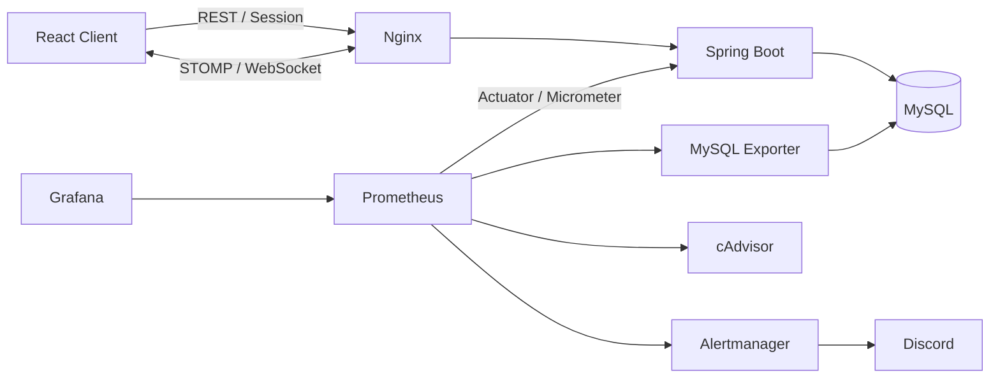

<p align="center">
  
</p>

# AntsWar

뉴스와 소문에 반응하며 가상의 종목을 거래하는 **30분 단위 실시간 모의 투자 게임**입니다.
16개 종목의 가격이 3초마다 변하고, 사용자는 LONG·SHORT 거래와 아이템을 활용해 자산 순위를 경쟁합니다. REST API로 거래를 처리하고 STOMP/WebSocket으로 가격, 뉴스, 채팅, 게임 상태를 실시간 전송합니다.

> [서비스 바로가기](https://개미전쟁.com)

## 주요 기능

- 30분 단위 게임 및 3초 주기의 종목 가격 갱신
- 16개 가상 종목 LONG·SHORT 거래와 포트폴리오 관리
- 뉴스·루머·아이템을 활용한 가격 예측
- 실시간 가격, 순위, 공지, 채팅 전송
- HTTP Session 기반 사용자 식별 및 WebSocket Handshake 연동
- 게임 종료 결과와 개인 파산 이벤트 제공

## 시스템 구성



서버는 단일 JVM으로 운영합니다. 동일 사용자의 상태 변경은 사용자 ID 기반 `ReentrantLock`으로 직렬화하고, 전체 가격 갱신과 사용자 요청의 충돌은 `ReentrantReadWriteLock`으로 제어합니다.

## 주요 문제 해결

### 1. 가격 갱신과 거래 간 데이터 정합성 확보

3초 주기의 가격 갱신과 사용자 거래가 동시에 같은 포지션을 변경하면 거래 결과가 유실되거나, 상장폐지로 정리된 포지션이 다시 살아나는 Lost Update가 발생할 수 있었습니다.

- 사용자 거래: Shared Lock
- 가격 갱신: Exclusive Lock
- 동일 사용자 요청: 사용자 ID 기반 Striped `ReentrantLock`

`CountDownLatch`로 가격 갱신과 매도를 의도적으로 경합시키는 통합 테스트를 작성했습니다. 가격 갱신이 진행되는 동안 매도가 대기하고, 상장폐지 이후에는 거래가 거부되며 포지션 수량과 잔액이 유지되는 것을 검증합니다.

### 2. 락 적용에 따른 성능 영향 검증

정합성을 위해 추가한 락이 사용자 요청을 과도하게 지연시키지 않는지 확인하기 위해 WebSocket과 HTTP 요청을 혼합한 k6 시나리오를 구성했습니다.

측정 당시 시나리오:

- 가상 사용자 100명
- 각 사용자가 WebSocket 연결을 1분간 유지
- WebSocket으로 게임 갱신 이벤트를 수신하면서 아이템 구매 API 호출
- 아이템 요청 주기 500ms

| 지표                  |         결과 |
| --------------------- | -----------: |
| HTTP 처리량           | 약 192 req/s |
| HTTP 요청             |     12,042건 |
| 요청 실패율           |           0% |
| 아이템 구매 p95       |      47.04ms |
| 아이템 구매 p99       |     290.62ms |
| WebSocket 연결 성공률 |         100% |
| STOMP 오류            |          0건 |

이 결과는 실제 사용자 수나 시스템의 최대 처리량을 의미하지 않습니다. 명시한 서버 환경과 시나리오에서 락 적용 후의 오류율과 응답시간을 검증한 결과입니다.

### 3. 누적 가격 이력 조회 성능 개선

가격 이력이 100만 건 이상 누적되면서 최근 5분 조회에 약 1.5초가 소요되는 문제가 발생했습니다.

`EXPLAIN`에서 `type=ALL`, `key=NULL`인 Full Table Scan을 확인했습니다. 조회 조건은 종목 ID의 동등 조건과 기록 시각의 범위 조건으로 구성되어 있어 다음 복합 인덱스를 적용했습니다.

```sql
CREATE INDEX idx_price_history_purchase_time
    ON price_history (purchase_id, recorded_at);
```

| 구분           | 최근 5분 조회시간 |
| -------------- | ----------------: |
| 인덱스 적용 전 |              1.5s |
| 인덱스 적용 후 |             0.15s |

조회시간을 약 90% 단축했습니다. Prometheus와 Grafana는 부하 테스트 중 서버 지표를 확인하고 운영 중 슬로우 쿼리를 발견하는 데 사용했습니다.

### 4. 초기 포지션 생성 비용 제거

기존에는 사용자가 입장할 때 16개 종목의 LONG·SHORT 포지션을 모두 생성했습니다. 실제 거래 여부와 무관하게 사용자당 32개의 `Position` INSERT가 발생했고, 100명이 동시에 입장하면 3,200개의 초기 INSERT가 실행되는 구조였습니다.

포지션을 최초 거래 시점에 생성하도록 변경해 입장 시 초기 `Position` INSERT를 제거했습니다.

```text
사용자당 초기 Position INSERT: 32건 → 0건
100명 입장 기준:             3,200건 → 0건
```

## 실시간 통신

- STOMP 연결은 `StompProvider`에서 하나의 연결로 관리합니다.
- 게임별 Topic은 `GameSocketProvider`가 구독하고 이벤트 타입별 Handler로 전달합니다.
- 연결 종료 시 1초부터 최대 30초까지 재연결 간격을 증가시킵니다.
- HTTP Session의 사용자 정보를 WebSocket Handshake에서 확인해 `Principal`로 연결합니다.
- 트랜잭션이 커밋된 이후에만 WebSocket 이벤트를 발행합니다.

## 모니터링

Prometheus가 Spring Boot, MySQL, 컨테이너 지표를 수집하고 Grafana에 사전 구성된 대시보드를 제공합니다.

- HTTP 응답시간과 JVM Heap·GC
- MySQL 커넥션과 Slow Queries
- 컨테이너 CPU·메모리·재시작
- Backend/MySQL 중단, Heap·컨테이너 메모리 80% 초과 알림
- Alertmanager를 통한 Discord 알림

저사양 서버 운영을 위해 Prometheus 보존 기간, cAdvisor 수집 지표, JVM Heap과 컨테이너별 메모리 상한을 제한합니다.

## 기술 스택

| 영역     | 기술                                                                               |
| -------- | ---------------------------------------------------------------------------------- |
| Frontend | React 19, TypeScript, Vite, TanStack Query, Zustand, Tailwind CSS, STOMP, Recharts |
| Backend  | Java 21, Spring Boot 4, Spring Data JPA, Spring WebSocket, Flyway                  |
| Database | MySQL 8, H2(Test)                                                                  |
| Infra    | Nginx, Docker Compose, Prometheus, Grafana, Alertmanager, cAdvisor                 |
| Test     | JUnit 5, k6                                                                        |

## 프로젝트 구조

```text
AntsWar
├── frontend/                  # React 클라이언트
│   └── src/
│       ├── entities/          # 도메인 상태와 UI
│       ├── features/          # 거래, 게임, 채팅, 아이템 기능
│       ├── widgets/           # 게임 화면 조합
│       └── shared/            # API, STOMP, 공통 UI
├── backend/                   # Spring Boot 서버
│   └── src/main/java/.../
│       ├── game/api/          # REST API
│       ├── game/application/  # 유스케이스, Tick 처리
│       ├── game/domain/       # 게임 도메인
│       └── game/infrastructure/
├── k6/                        # HTTP·WebSocket 부하 테스트
├── prometheus/                # 수집 대상과 Alert Rule
├── grafana/                   # Provisioning과 Dashboard
├── alertmanager/              # Discord 알림
├── nginx/                     # HTTPS·REST·WebSocket Reverse Proxy
└── docker-compose*.yml
```

## 배포와 모니터링 명령

```bash
# 개발용 이미지 빌드 및 실행
make dev

# 운영 이미지 실행
make prod

# Prometheus, Exporter, cAdvisor, Alertmanager 실행
make monitoring

# Grafana 실행
make local
```

민감한 DB 비밀번호와 Discord Webhook은 `.env`로 주입하며 저장소에 포함하지 않습니다.
